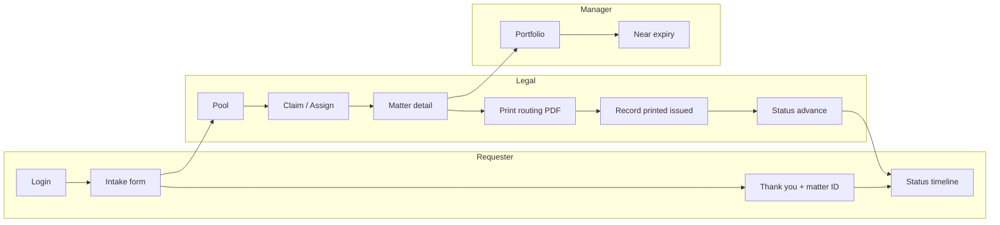

# Gardenia (GBPI) Legal Contract Ops Pilot — Design Brief

**Product:** DSSI Operational Gap Audit — GBPI Legal Contract Operations (pilot MVP)  
**Author:** DSSI Design  
**Inputs:** [product-brief.md](./product-brief.md), [tech-plan.md](./tech-plan.md), Gardenia Legal meeting notes  
**Language ASSUMPTION:** English UI (Tagalog optional post-pilot)  
**Platform ASSUMPTION:** Desktop-first web (1280px+ primary); responsive for requester status checks on mobile  

---

## Design brief

### User & success moment

**Primary success moment (champion demo):** The senior paralegal opens **Assignment pool**, claims one intake, opens **Matter detail**, records physical custody, generates and prints a **LEG-FORM-5** routing PDF, marks **printed copy issued**, and advances status to **Internal Review**—while a Purchasing requester refreshes **My requests** and sees the updated timeline **without emailing Legal**.

**Secondary success moments**

| Role | Moment |
| --- | --- |
| **Requester** | Submits intake, receives matter ID + email, tracks status timeline to completion. |
| **Legal staff** | One place to update status, custody, and artifact pointers; Google Doc link preserved. |
| **Legal Manager** | Portfolio shows workload by assignee + **Near expiry (≤90d)** list with drill-down. |
| **Execom (read-only narrative)** | Demo proves expiry visibility and audit trail—not “AI replaces attorneys.” |

**Jobs the UI must not break**

- Wet-ink routing culture: print path is primary; digital routing hidden unless `digitalRoutingSlipEnabled` is ON (staging/demo only).
- Google Docs remains drafting surface: prominent **Open Google Doc** pointer, not in-app editor.
- No legal advice: AI surfaces are labeled, collapsible, and never auto-run on page load (except deterministic expiry flags).

---

### Flow

**Happy path (demo script ≤25 min — AC-P3)**

1. **Requester** signs in → **New contract request** → completes entity, dept, type, counterparty, proponent, priority, attachments, optional GDoc URL → **Submit**.
2. **System** issues `matter_number`, email receipt, matter status **Submitted** → **In Pool** (≤5s).
3. **Senior paralegal** → **Assignment pool** → reviews row → **Claim** (or assigner **Assign to…**).
4. **Matter detail** → status **Assigned** → **Drafting**; updates **Physical custody** + optional desk note; sets **Latest artifact** (upload or link); audit logs changes.
5. **Routing slip** → review prefill (AI4 optional, user confirms) → **Download PDF** (LEG-FORM-5 layout) → print wet-ink blocks.
6. Check **Printed copy issued** + date → advance to **Internal Review** (gate enforced).
7. Continue workflow: **Final Approval** → **Notarization** (if needed) → **Completed**.
8. **Requester** **My requests** / matter status shows timeline (last 10 events).
9. **Manager** → **Portfolio** → filter **Near expiry** → open matter → verify dates + owner.
10. **Assistive AI** (optional beat): **Copy status summary** for email (AI1) with disclaimer; expiry flag on record missing end date (AI2).



**Edge flows (must design, not improvise in eng)**

| Flow | Trigger | UX outcome |
| --- | --- | --- |
| **Illegal status transition** | User selects disallowed next state | Inline error on status control; no silent fail; explain precondition (e.g. print gate). |
| **On Hold** | Legal pauses work | Status badge + timeline event; requester sees hold reason (required short note). |
| **Cross-dept denied** | Requester opens other dept matter | 403 page: “You don’t have access” + link to own requests. |
| **Import bootstrap** | Admin CSV wizard | Stepper: upload → map columns → preview → run → error report table. |
| **AI kill switch** | `AI_ENABLED=false` | AI buttons absent; expiry flags remain (rule-based). |
| **Digital routing OFF** | Production pilot | No signature/approval inputs on slip; PDF + print only. |
| **Digital routing ON** | Staging demo | Secondary panel “Digital approvals (pilot)” below print actions; audit-only clicks. |

---

### First viewport

#### Login / app entry (`/` or `/login`)

**Purpose:** Trust + fast entry for ≤8 known users; no marketing fluff.

| Zone | Content |
| --- | --- |
| **Top** | GBPI wordmark + product name: **Legal Contract Ops** (pilot). Subline: “Status, custody, and expiry—not drafting.” |
| **Center** | Single card: **Sign in with Google** (primary) + **Email magic link** (secondary). No password fields in v1 ASSUMPTION. |
| **Footer** | DSSI pilot footer: support contact, data handling one-liner, version tag. |

**Composition rules:** One column, max-width 420px card on neutral page background; no hero illustration; optional subtle line-art of routing slip silhouette at 8% opacity (not a photo).

#### Role home (first paint after auth)

**Requester home**

- H1: **My contract requests**
- Primary CTA: **New request**
- Table/cards: open matters with **status chip**, **matter_number**, **counterparty**, **last updated**
- Empty: illustration-free; text + CTA only

**Legal home**

- H1: **Work queue**
- Two prominent counts: **In pool (n)** → link to pool; **My active matters (n)**
- Compact **Needs attention**: custody blank, print gate blocking review, missing expiry (deterministic)

**Manager home**

- H1: **Portfolio**
- First row KPI strip: Active / Near expiry / Unknown end date / Unassigned in pool (numbers only, no charts in v1)

**Desktop layout shell (all authenticated roles)**

- **Left nav** (240px): role-filtered items; current matter context keeps nav visible.
- **Top bar:** global search (Legal/Manager), user menu, entity switcher if multi-entity pilot.
- **Content:** single primary column + optional right rail on matter detail only (timeline).

---

### IA / sections

```text
Gardenia Legal Contract Ops (pilot)
├── Public
│   └── Login
├── Requester
│   ├── Home (my requests)
│   ├── New request (intake)
│   ├── Request detail / status (timeline read-only)
│   └── (Optional) Magic-link status — NEEDS CEO
├── Legal
│   ├── Home (queue summary)
│   ├── Assignment pool
│   ├── Matters (search + filters)
│   └── Matter detail
│       ├── Overview (metadata, status, assignee)
│       ├── Timeline & audit
│       ├── Custody & location
│       ├── Artifacts & pointers (GDoc, files)
│       ├── Routing slip (print + optional digital — flag)
│       └── Assistive AI panel
├── Manager
│   ├── Portfolio (workload table)
│   ├── Expiry watch (90/30/7 buckets)
│   └── Matters (read-only detail)
└── Admin (pilot)
    ├── Import wizard
    └── Users (seed / invite ASSUMPTION)
```

**Navigation labels (exact copy for eng)**

| ID | Label | Roles |
| --- | --- | --- |
| `nav.home` | Home | all |
| `nav.new` | New request | requester |
| `nav.pool` | Assignment pool | legal, assigner |
| `nav.matters` | Matters | legal, manager |
| `nav.portfolio` | Portfolio | manager |
| `nav.expiry` | Expiry watch | manager, legal |
| `nav.import` | Import data | admin |

**Information hierarchy — Matter detail (Legal)**

1. **Status + matter_number** (page title row)
2. **Next actions** (status dropdown with allowed edges only; disabled options show tooltip why)
3. **Custody strip** (always visible below title)
4. **Two-column body (desktop):** metadata left | timeline right rail
5. **Tabs or anchored sections:** Artifacts · Routing slip · Assistive tools

---

### Key screens

#### 1. Intake form (`/request/new`)

- **Step feel:** Single page form (no wizard) for pilot speed; sections: **Request info**, **Parties**, **Attachments & links**.
- **Required:** entity, department, contract type, title/summary, counterparty, proponent, priority.
- **Optional:** GDoc URL, files (PDF/DOCX), internal notes to Legal.
- **Submit:** primary button; secondary **Save draft** deferred post-pilot (omit in v1 to reduce scope).
- **Success:** dedicated thank-you with **matter_number**, what happens next, link to status view, “email sent” confirmation.

#### 2. Assignment pool (`/legal/pool`)

- **Table columns:** matter_number, title, dept, type, priority, submitted, age in pool.
- **Row actions:** **Claim** (legal), **Assign…** (assigner modal with user picklist).
- **Filters:** entity, dept, priority, contract type.
- **Empty:** “No contracts waiting in the pool” + link to Matters search.

#### 3. Matter detail — Legal (`/legal/matters/:id`)

- **Status control:** horizontal **stage stepper** (read-only past, current highlighted, future muted) + **Change status** dropdown for allowed transitions only.
- **Custody card:** “Physical: with [person/role]” + note; edit opens small modal; every save → timeline event.
- **Artifacts card:** list with kind badges; one **Mark as latest** per kind; **Add** upload or URL; **System of record** toggle (`app` | `gdocs` | `physical`).
- **Routing slip card:** preview field summary → **Generate PDF** → **Record printed copy issued** (date picker default today).
- **Print gate:** if advancing to Internal Review without print recorded, block with explicit callout pointing to routing card.

#### 4. Requester status (`/request/status/:id` or shared list row)

- **No legal controls.** Timeline vertical list (newest first or oldest first — **recommend oldest-first** for story readability).
- **AI1:** “Copy plain-language summary” button → modal with text + disclaimer + copy to clipboard (not auto-email in UI v1 ASSUMPTION).

#### 5. Manager portfolio (`/manager/portfolio`)

- **Workload table:** assignee | active count | in review | on hold | oldest open (days).
- **No rankings / leaderboard** — meeting asked for rankings; product **excludes**; do not show comparative scores.
- **Expiry watch** (`/manager/expiry`): sortable table, buckets as tabs; columns: matter_number, title, counterparty, end date, days remaining, assignee, custody.

#### 6. Search (`/legal/matters` + Manager read-only)

- **Filter bar:** entity, dept, type, status, assignee, expiry bucket, counterparty typeahead.
- **AI3 assist:** single field “Describe what you’re looking for” → applies suggested filters chip row; user confirms **Apply**.
- **Results:** max 50 per page; skeleton rows while loading.

#### 7. Routing slip — LEG-FORM-5 PDF (print)

- **On-screen preview:** monochrome table matching familiar rows: Prepared / Reviewed / Approved / Remarks; signature **blank lines** (wet ink).
- **Print CSS:** US Letter or A4 ASSUMPTION — **NEEDS paralegal** template sign-off; margins for office printers.
- **Digital (flag ON):** collapsible section under preview; per-row “Record approval” only if flag; never replaces print layout.

#### 8. Import wizard (`/admin/import`)

- Upload → column mapping drag/target dropdowns → validation preview → results with downloadable error CSV.

---

### States

| Surface | Empty | Loading | Error | Success |
| --- | --- | --- | --- | --- |
| **Pool** | Zero-state copy + refresh | Skeleton table 5 rows | Banner “Couldn’t load pool” + retry | N/A (list) |
| **My requests** | CTA new request | Skeleton cards | Same banner pattern | Toast on new submit (optional) |
| **Matter detail** | N/A | Full-page skeleton for header + timeline | 404 / 403 dedicated pages | Inline toast on save; status change shows timeline append |
| **Search** | “No matters match” + clear filters | Skeleton + disable filters | Search failed retry | Result count header |
| **Routing PDF** | Disabled until matter loaded | Spinner on Generate | Generation failed message | Opens PDF tab + “Recorded print” checkbox enabled |
| **AI summary** | Button idle | Spinner in modal | “Summary unavailable” + no fabricated text | Modal with disclaimer footer sticky |
| **Import** | Upload dropzone empty | Progress bar on job | Error report table highlighted rows | Success counts + link to matters |
| **Status transition** | — | Button loading | Inline alert with API message (409 illegal edge) | Timeline auto-scroll to new event |

**403 / 404 pages:** Calm, text-only; one link back to role home; no illustration clutter.

---

### Visual direction

**Mood:** Calm enterprise legal operations—paper, ink, filing clarity. Feels like a modern internal operations tool, not a consumer app or “AI legal startup.”

**Avoid:** Purple gradients, cream + terracotta palettes, broadsheet newspaper density, neon glow, emoji in chrome, glassmorphism, card farms in hero.

**Do:**

- High readability: generous line-height, clear table typography.
- Status communicated by **label + color dot** (not color alone).
- Physical custody called out with distinct but sober accent (e.g. slate border-left card).
- Print/routing actions use **outline** buttons; destructive actions rare and text-only secondary.

**Typography ASSUMPTION**

- **UI:** `IBM Plex Sans` or `Source Sans 3` (system fallback stack).
- **Matter numbers / IDs:** tabular nums, `IBM Plex Mono` or monospace utility class.
- **PDF / routing preview:** serif optional for template fidelity ASSUMPTION — match LEG-FORM-5 Word; UI stays sans.

**CSS variable sketch (implement in `globals.css`)**

```css
:root {
  /* Brand — GBPI-adjacent without loud consumer bakery cues */
  --color-brand-primary: #1e4d3a;      /* deep garden green */
  --color-brand-primary-hover: #163a2c;
  --color-brand-on-primary: #ffffff;

  /* Neutrals — cool gray, not warm cream */
  --color-bg-page: #f4f6f8;
  --color-bg-surface: #ffffff;
  --color-bg-elevated: #ffffff;
  --color-border-subtle: #e2e6ea;
  --color-border-strong: #c5ccd3;
  --color-text-primary: #1a1f24;
  --color-text-secondary: #5c6670;
  --color-text-muted: #8a939c;

  /* Status — muted, dot + label */
  --color-status-submitted: #6b7280;
  --color-status-pool: #2563eb;
  --color-status-assigned: #0d9488;
  --color-status-drafting: #ca8a04;
  --color-status-review: #9333ea;      /* use sparingly; pair with text label */
  --color-status-approval: #1e4d3a;
  --color-status-notary: #4b5563;
  --color-status-completed: #15803d;
  --color-status-hold: #b45309;

  /* Semantic */
  --color-danger: #b91c1c;
  --color-warning: #a16207;
  --color-success: #166534;
  --color-info: #1d4ed8;

  /* Custody / physical */
  --color-custody-accent: #334155;
  --color-custody-bg: #f1f5f9;

  /* AI assist — visually secondary */
  --color-ai-border: #cbd5e1;
  --color-ai-bg: #f8fafc;

  /* Typography */
  --font-sans: "IBM Plex Sans", "Segoe UI", system-ui, sans-serif;
  --font-mono: "IBM Plex Mono", ui-monospace, monospace;
  --text-page-title: 1.5rem;
  --text-section-title: 1.125rem;
  --text-body: 0.9375rem;
  --text-caption: 0.8125rem;

  /* Layout */
  --nav-width: 240px;
  --content-max: 1200px;
  --radius-sm: 4px;
  --radius-md: 6px;
  --shadow-card: 0 1px 2px rgba(26, 31, 36, 0.06);

  /* Focus */
  --focus-ring: 0 0 0 2px var(--color-bg-surface), 0 0 0 4px var(--color-brand-primary);
}
```

**Components (shadcn-compatible ASSUMPTION per tech plan)**

- Tables for pool, portfolio, search results (not card grids).
- **StatusChip** component: dot + enum label + optional “On hold” icon (SVG, not emoji).
- **Timeline** component: vertical list, actor name, timestamp, event type label.
- **DisclaimerBanner** for AI: persistent in AI modal footer; smaller inline on AI3 search assist.

---

### Motion

**Max 3 purposeful motions**

1. **Timeline event append:** new row fades in (150ms) + subtle highlight fade (400ms) after status change.
2. **Pool count badge:** number tick on claim (optional; respect `prefers-reduced-motion` — swap to instant update).
3. **Modal / drawer:** routing preview and AI summary slide up 200ms ease-out; reduced motion → instant.

No page transitions, no parallax, no loading spinners on every nav click (use RSC skeletons instead).

---

### Accessibility

- **WCAG 2.1 AA target** for pilot; focus visible on all interactive elements (`--focus-ring`).
- **Status:** never color-only; always text label on chips and stepper.
- **Forms:** explicit `<label>`, `aria-describedby` for help text; errors linked to fields.
- **Tables:** scope headers; pool row actions keyboard reachable (Tab → Claim).
- **Stepper:** current step `aria-current="step"`.
- **AI modal:** focus trap; disclaimer read by screen readers (not `aria-hidden`).
- **PDF:** provide non-PDF summary of routing metadata on page for screen reader users.
- **Contrast:** body text ≥4.5:1 on white; status dots paired with text.
- **Touch (mobile status check):** min 44px tap targets on requester list rows and timeline expanders.

**Mobile ASSUMPTION (secondary)**

- Requester **My requests** + **Status timeline** stack single column; nav collapses to bottom bar with Home + New only.
- Legal matter editing remains desktop-recommended; show banner on narrow viewports: “Use desktop for assignment and routing.”

---

### Decisions for CEO

| # | Decision | Design recommendation |
| --- | --- | --- |
| 1 | Public magic-link status vs login-only | **Login-only** for simpler ACL; optional read-only token page as separate lightweight template if AC-A4 literal required. |
| 2 | Bilingual UI | **English v1**; prepare strings file for Tagalog later. |
| 3 | Entity switcher | Show if ≥2 pilot entities; default last used in localStorage. |
| 4 | Digital routing in demo | UI exists but **hidden** unless flag ON; staging banner “Demo: digital approvals enabled.” |
| 5 | LEG-FORM-5 paper size | Paralegal sign-off on PDF screenshot before pilot UAT. |
| 6 | “Save draft” on intake | **Omit v1** to reduce scope. |
| 7 | In-app notifications | **Defer**; email receipt + status emails sufficient; no bell icon in pilot. |

---

### Handoffs

#### Engineer

| Item | Spec |
| --- | --- |
| **Routes** | Align with tech-plan §4.11: `/request/new`, `/legal/pool`, `/legal/matters/:id`, `/manager/portfolio`, `/manager/expiry`, `/admin/import`. |
| **Shell** | Role-based nav from `GET /api/me`; hide Manager nav for requesters. |
| **Matter detail layout** | Title row + stepper + custody strip; right rail timeline ≥1024px; stack <1024px. |
| **Status UI** | Fetch allowed transitions from API; disable illegal options with tooltip precondition text. |
| **Print gate** | When `Internal Review` selected without `printed_copy_issued_at`, show `PrintGateCallout` component (design above fold in routing section). |
| **Feature flag** | `GET /api/config/features` — hide digital approval UI when `digitalRoutingSlipEnabled === false`. |
| **AI UI** | Shared `AssistivePanel`: buttons AI1/AI5 only on explicit click; API `disclaimer` rendered in footer; `AI_ENABLED=false` removes panel. |
| **403/404** | Shared templates per role home link. |
| **Tokens** | Implement CSS variables above; StatusChip maps `matter.status` enum to CSS status colors. |
| **PDF** | On-screen preview approximates PDF; print uses React-PDF output; wet signature fields empty lines. |
| **Components to build first (week 2)** | `AppShell`, `StatusStepper`, `StatusChip`, `MatterTimeline`, `CustodyCard`, `PoolTable`, `DisclaimerBanner`. |
| **E2E selectors** | `data-testid` on pool claim, status change, print issued checkbox, matter_number display. |

#### Marketer

- Screenshots for proposal: **before** (Excel/email) vs **after** (pool + timeline + expiry table)—use real empty states, not lorem hero.
- Demo storyboard frames: intake thank-you → pool claim → print PDF → requester timeline → manager expiry tab.

#### QA

- Role matrix visual: capture 403 screens for cross-dept requester.
- PDF visual checklist vs Word LEG-FORM-5.
- AI disclaimer present on AI1, AI3, AI5 modals (AC-AI5).
- `prefers-reduced-motion`: no timeline animation.
- Mobile: requester timeline usable at 375px width.

---

## Appendix A — Status stepper (visual spec)

Horizontal stages (wrap on small screens):

`Submitted` → `In Pool` → `Assigned` → `Drafting` → `Internal Review` → `Final Approval` → `Notarization` → `Completed`

**On Hold:** overlays current stage with amber badge; stepper position unchanged.

---

## Appendix B — AI copy (fixed strings)

| Key | Text |
| --- | --- |
| `ai.disclaimer.short` | Assistive only. Not legal advice. An attorney must review all decisions. |
| `ai.disclaimer.footer` | This summary is generated from matter metadata and audit events. Dates and facts may be incomplete—verify in the record. |
| `ai.empty` | No matching matters. Try adjusting filters. |
| `ai.summary.action` | Generate status summary |

---

## Appendix C — Email ↔ UI parity

Status emails should deep-link to the same **timeline** view requesters see in-app (authenticated URL ASSUMPTION).

---

*End of design brief.*