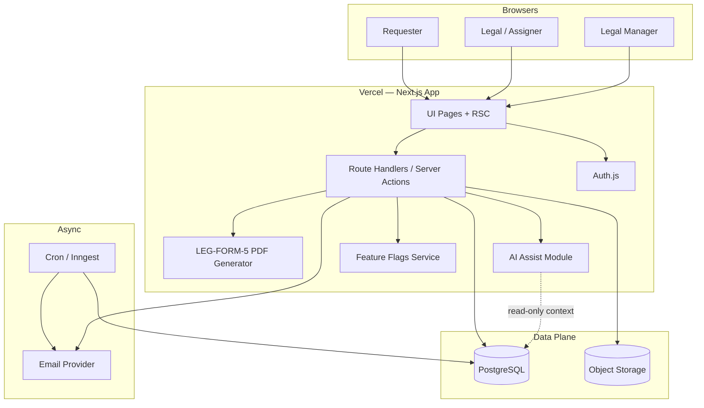
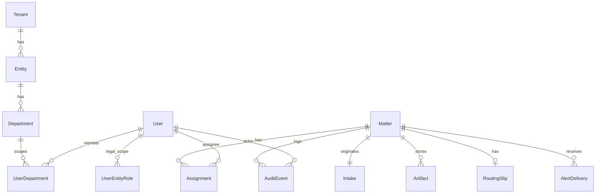

# GBPI Legal Contract Ops Pilot — Technical Plan

**Author:** DSSI Engineering  
**Status:** Plan only (no application build in this artifact)  
**Inputs:** [product-brief.md](./product-brief.md), Gardenia meeting package (`LEG-FORM-5`, repository XLSX, workflow notes)  
**Pilot window ASSUMPTION:** 4–8 week build + 2–4 week supervised use

---

## 1. Technical goal

Deliver a **greenfield, print-first web application** that gives GBPI Legal a thin operational layer over today’s Google Docs + email + wet-ink routing: **one intake → assignment pool → status timeline → canonical matter record → expiry visibility → searchable history**, with **assistive AI** that never mutates workflow state or gives legal advice.

Success for engineering is not feature completeness vs. a CLM—it is a **credible week-2 vertical slice** (submit → pool → assign → status → audit) and a **≤25-minute demo path** (intake → pool → LEG-FORM-5 PDF → expiry alert → search → assistive summary) that satisfies product acceptance criteria **AC-A\*** through **AC-R\*** and **AC-P3**.

**Non-negotiable guardrails**

| Guardrail | Implementation stance |
| --- | --- |
| Wet-ink culture | Printable routing slip is P0; digital capture behind `digitalRoutingSlipEnabled` (default **OFF**) |
| Google Docs stays drafting surface | Store **URL pointer** + optional milestone snapshots only—no GDocs API in pilot |
| AI assistive only | Server-side LLM calls; **no** tool/function that writes `Matter.status` or `AuditEvent` without explicit human API action |
| Pilot scale | ≤8 Legal users, 1–2 entities, 2–3 departments, ≤500 matter rows (ASSUMPTION) |
| PDF full-text indexing | **OFF** by default; metadata + on-request upload analysis for AI5 only |

---

## 2. Architecture

### 2.1 Stack (ASSUMPTION — boring monolith)

| Layer | Choice | Rationale |
| --- | --- | --- |
| **App** | **Next.js 15** (App Router, TypeScript, React Server Components where useful) | One repo, fast UI iteration, API routes / Server Actions for pilot |
| **DB** | **PostgreSQL 16** (managed) | Relational ACL, audit, search filters; boring and proven |
| **ORM / migrations** | **Drizzle ORM** + SQL migrations | Lightweight, type-safe, easy CSV bootstrap scripts |
| **Auth** | **Auth.js (NextAuth v5)** — Google OAuth + email magic link | Pilot-friendly; SSO deferred **NEEDS CEO** |
| **Hosting** | **Vercel** (app) + **Neon** or **Supabase** (Postgres) | Default DSSI demo path; **GBPI IT data residency UNKNOWN / NEEDS CEO** |
| **Files** | **Vercel Blob** or S3-compatible bucket (ASSUMPTION: Blob for pilot) | Intake attachments + artifact uploads |
| **Email** | **Resend** (or SendGrid ASSUMPTION) | Status change + expiry digests |
| **PDF** | **React-PDF** (`@react-pdf/renderer`) for LEG-FORM-5 layout | Deterministic print layout; no headless Chrome ops in v1 |
| **Background jobs** | **Vercel Cron** + **Inngest** (or Trigger.dev ASSUMPTION) | Daily expiry scan, weekly digest |
| **AI** | **Vercel AI SDK** + OpenAI `gpt-4o-mini` (ASSUMPTION) | Cheap summaries; prompts in repo; rate limits per user |
| **Observability** | Vercel logs + Sentry (ASSUMPTION) | Pilot hypercare |

**Multi-tenant readiness ASSUMPTION:** Schema includes `tenant_id` (single value `gbpi-pilot` in config); no second tenant in pilot.

### 2.2 Component diagram



### 2.3 Data flow (happy paths)

**Intake → pool**

1. Requester authenticates (magic link / Google ASSUMPTION).
2. `POST /api/intakes` creates `Intake` + linked `Matter` (status `Submitted`), writes `AuditEvent`, sends receipt email.
3. Assigner action or auto-rule moves matter to `In Pool` (product: new submission in pool within 5s — AC-A2).

**Pool → assign → workflow**

1. Legal user **claims** (`POST .../claim`) or assigner **assigns** (`POST .../assign`) → `Assignment` row + status `Assigned` / `Drafting`.
2. Status transitions via `PATCH /api/matters/:id/status` — **state machine validates edges**; on success, audit + email stakeholders (AC-A3).
3. Before `Internal Review`: API requires `printed_copy_issued_at` on `RoutingSlip` or matter milestone fields (AC-R2).

**Repository / expiry**

1. Matter metadata holds effectivity dates; nightly job computes `expiry_bucket` (`Active` | `NearExpiry` | `Expired` | `Unknown`).
2. `AlertRule` thresholds 90/30/7 fire emails; weekly digest aggregates manager view (AC-B3).

**Routing slip (print-first)**

1. `GET /api/matters/:id/routing-slip.pdf` renders LEG-FORM-5 sections: company, contract type, proponent, reviewer rows (Prepared / Reviewed / Approved / Remarks), wet signature blanks.
2. AI4 pre-fills **metadata only** into slip draft endpoint; user confirms before PDF generation.
3. If `digitalRoutingSlipEnabled === true` (staging only ASSUMPTION): optional `POST .../routing-step-approvals` records click-to-approve per row; audit captures approver; print layout unchanged.

**Light AI**

1. **AI1:** `POST /api/matters/:id/ai/summary` — reads audit + status + metadata; prompt forbids inventing dates; response shown with disclaimer.
2. **AI2:** Deterministic rules in app **plus** optional LLM phrasing for digest lines (`missing_expiry`, date conflicts).
3. **AI3:** NL query → structured filter JSON → existing search SQL (metadata only).
4. **AI5:** On button click, parse uploaded PDF text in memory (no index); highlight spans returned to UI; file not retained for embedding unless CEO approves indexing.

### 2.4 Deployment topology (ASSUMPTION)

| Environment | Purpose | `digitalRoutingSlipEnabled` |
| --- | --- | --- |
| `dssi-demo` | Sales / Execom dry run | ON (optional demo path) |
| `gbpi-pilot` | Live pilot | **OFF** (CEO recommend) |
| `local` | Dev | Configurable |

Secrets: `DATABASE_URL`, `AUTH_SECRET`, `GOOGLE_CLIENT_*`, `RESEND_API_KEY`, `OPENAI_API_KEY`, `BLOB_READ_WRITE_TOKEN` — never in client bundle.

---

## 3. Core data model

Identifiers: UUID primary keys; human-readable **`matter_number`** (e.g. `GBPI-2026-0042`) from sequence per entity.

### 3.1 Entity-relationship (logical)



### 3.2 Tables (pilot)

#### `tenants`, `entities`, `departments`

| Table | Key fields | Notes |
| --- | --- | --- |
| `tenants` | `id`, `name`, `config_json` | Single row pilot; holds feature flags snapshot |
| `entities` | `id`, `tenant_id`, `code`, `name` | e.g. GBPI, Nutribaked |
| `departments` | `id`, `entity_id`, `code`, `name` | Purchasing, Marketing |

#### `users`, ACL

| Table | Key fields | Notes |
| --- | --- | --- |
| `users` | `id`, `email`, `name`, `role` | Enum: `requester`, `legal`, `assigner`, `manager`, `admin` |
| `user_departments` | `user_id`, `department_id` | Requesters scoped to dept |
| `user_entity_roles` | `user_id`, `entity_id`, `role` | Legal sees all depts in entity |

**ACL rule (enforced in service layer + SQL):**

- Requester: read matters where `matter.department_id` ∈ user departments.
- Legal / assigner: read/write matters in pilot `entity_id` set.
- Manager: read all matters in tenant entities; no destructive admin unless `admin`.

#### `matters` (canonical record — B1)

| Column | Type | Notes |
| --- | --- | --- |
| `id`, `tenant_id`, `entity_id`, `department_id` | FK | |
| `matter_number` | text unique | AC-A1 |
| `title`, `contract_type`, `counterparty`, `proponent_name`, `priority` | text / enum | Maps from intake + import |
| `status` | enum | See §3.3 state machine |
| `assignee_user_id` | FK nullable | Current owner |
| `google_doc_url` | text nullable | Pointer only |
| `system_of_record` | enum | `app` \| `gdocs` \| `physical` |
| `effectivity_start`, `effectivity_end` | date nullable | B3 |
| `expiry_bucket` | enum computed | Cached by job |
| `physical_custody` | text | "Physical: with [name/role]" A4 |
| `custody_note` | text | Desk/shelf |
| `printed_copy_issued_at` | timestamptz nullable | R2 gate |
| `created_at`, `updated_at` | timestamptz | |

#### `intakes` (A1)

| Column | Notes |
| --- | --- |
| `id`, `matter_id` (1:1) | Intake may be merged into matter after pilot; separate table keeps audit of original submission |
| `submitted_by_user_id`, `submitted_at` | |
| `payload_json` | Snapshot of form at submit |
| `attachments` | Via `artifacts` linked with `kind=intake_attachment` |

#### `assignments` (A3)

| Column | Notes |
| --- | --- |
| `id`, `matter_id`, `assignee_user_id` | History preserved: `unassigned_at`, `assigned_by_user_id` |
| `source` | `claim` \| `manual` \| `round_robin_hint` (future) |

#### `artifacts` (B1)

| Column | Notes |
| --- | --- |
| `id`, `matter_id`, `kind` | `intake_attachment`, `milestone_snapshot`, `imported_file`, `latest_executed` |
| `storage_key`, `filename`, `mime`, `size_bytes` | Blob reference |
| `is_latest` | bool — one per kind per matter (ASSUMPTION) |
| `google_doc_url` | alternative to upload |
| `uploaded_by`, `uploaded_at` | |

#### `routing_slips` (R1)

| Column | Notes |
| --- | --- |
| `id`, `matter_id` | 1:1 active slip per matter version ASSUMPTION |
| `template_version` | `leg-form-5-v1` |
| `company`, `contract_type`, `proponent` | Denormalized for PDF |
| `reviewer_rows_json` | Array: `{ role, name, signature_blank, date_blank, reviewed, approved, remarks }` |
| `printed_copy_issued_at` | Mirrors matter gate |
| `digital_steps_json` | Only when flag ON: `{ step_id, approved_at, approved_by }` |

#### `audit_events` (A6)

| Column | Notes |
| --- | --- |
| `id`, `matter_id`, `actor_user_id`, `occurred_at` | Immutable append-only |
| `event_type` | `status_change`, `custody_update`, `assignment`, `artifact_upload`, `routing_print`, `digital_approval`, `import`, `ai_summary_requested` |
| `before_json`, `after_json` | |
| `ip_hash` | Optional ASSUMPTION |

#### `alert_rules` + `alert_deliveries` (B4)

| Table | Notes |
| --- | --- |
| `alert_rules` | Seed rows: thresholds 90, 30, 7 days; weekly digest |
| `alert_deliveries` | `matter_id`, `rule_id`, `sent_at`, `channel` (`email`), dedupe key |

#### `feature_flags`

| Column | Notes |
| --- | --- |
| `key` | `digitalRoutingSlipEnabled` |
| `enabled` | bool; env override `FEATURE_DIGITAL_ROUTING` |
| `environment` | `production` \| `staging` |

#### `import_jobs` (B6)

| Column | Notes |
| --- | --- |
| `id`, `status`, `filename`, `row_counts`, `error_report_json` | Partial failure reporting AC-B5 |

### 3.3 Status state machine (A2)

```
Submitted → In Pool → Assigned → Drafting → Internal Review → Final Approval → Notarization → Completed
                     ↘ On Hold (from most active states) ↗
```

**Transition rules**

| Transition | Preconditions |
| --- | --- |
| → `Internal Review` | `printed_copy_issued_at` set (AC-R2) |
| Illegal edge | HTTP 409; **no** audit row (AC-A3) |
| AI | Cannot call transition endpoints |

### 3.4 Expiry logic (B3)

Computed nightly (and on matter save):

| Bucket | Rule |
| --- | --- |
| `Unknown` | `effectivity_end` null |
| `Expired` | `end < today` |
| `NearExpiry` | `end ≤ today + 90d` |
| `Active` | else |

Fixed thresholds 90/30/7 for alerts (configurable post-pilot).

### 3.5 Import mapping (B6 — ASSUMPTION)

Paralegal supplies **one** entity/dept export. Wizard maps columns → matter fields:

| Source column (examples from repo sheets) | Target |
| --- | --- |
| Contract title / description | `title` |
| Type / CODE | `contract_type` |
| Counterparty | `counterparty` |
| End date | `effectivity_end` |
| Status text | `status` or `expiry_bucket` with mapping table |
| Dept / entity tab name | `entity_id`, `department_id` |

Max 200 rows pilot ASSUMPTION; idempotent upsert by `external_id` column if present in export.

---

## 4. API / interface contracts (high-level)

Base: `/api/v1/*` JSON; errors `{ error: { code, message, details? } }`. Auth: session cookie (Auth.js). All mutating routes require CSRF-safe Server Actions or POST with session.

### 4.1 Auth & users

| Method | Path | Description |
| --- | --- | --- |
| — | `/api/auth/*` | Auth.js handlers |
| GET | `/api/me` | Current user + roles + scoped depts/entities |
| POST | `/api/admin/users` | Admin invite (pilot: manual seed) |

### 4.2 Intake & matters

| Method | Path | Roles | Description |
| --- | --- | --- | --- |
| POST | `/api/intakes` | requester+ | Create intake + matter; AC-A1 |
| GET | `/api/matters` | scoped | List/filter (search B5) |
| GET | `/api/matters/:id` | scoped | Detail + timeline |
| PATCH | `/api/matters/:id` | legal+ | Metadata, custody (A4, A5) |
| PATCH | `/api/matters/:id/status` | legal+ | State machine transition |
| GET | `/api/matters/:id/timeline` | scoped | Last N audit events (AC-A4: 10) |

**Query params (search):** `entity`, `department`, `contract_type`, `counterparty`, `status`, `assignee`, `expiry_bucket`, `q` (title/metadata ilike).

### 4.3 Assignment pool

| Method | Path | Roles | Description |
| --- | --- | --- | --- |
| GET | `/api/pool` | legal, assigner | `In Pool` matters |
| POST | `/api/matters/:id/claim` | legal | Self-assign |
| POST | `/api/matters/:id/assign` | assigner | Assign to user_id |

### 4.4 Artifacts

| Method | Path | Description |
| --- | --- | --- |
| POST | `/api/matters/:id/artifacts` | Multipart upload → Blob |
| PATCH | `/api/artifacts/:id/latest` | Mark latest executed copy |

### 4.5 Routing slip

| Method | Path | Description |
| --- | --- | --- |
| GET | `/api/matters/:id/routing-slip` | JSON metadata |
| POST | `/api/matters/:id/routing-slip/prefill` | AI4 + intake merge; user confirms |
| GET | `/api/matters/:id/routing-slip.pdf` | Printable PDF (AC-R1) |
| POST | `/api/matters/:id/routing-slip/printed` | Set `printed_copy_issued_at` |
| POST | `/api/matters/:id/routing-slip/digital-approval` | **403 if flag OFF**; else record step (AC-R3) |

### 4.6 Alerts & digests

| Method | Path | Description |
| --- | --- | --- |
| GET | `/api/alerts/upcoming` | manager, legal | Near expiry lists |
| POST | `/api/cron/expiry-scan` | Inngest/cron secret | Internal |
| POST | `/api/cron/weekly-digest` | Internal | |

### 4.7 Import

| Method | Path | Description |
| --- | --- | --- |
| POST | `/api/import/csv` | Upload + column mapping |
| POST | `/api/import/xlsx` | Single sheet |
| GET | `/api/import/:jobId` | Status + error report |

### 4.8 AI (assistive)

| Method | Path | Description |
| --- | --- | --- |
| POST | `/api/matters/:id/ai/summary` | AI1 — no mutation |
| GET | `/api/matters/:id/ai/expiry-flags` | AI2 rules + optional copy |
| POST | `/api/search/assist` | AI3 → suggested filters |
| POST | `/api/artifacts/:id/ai/highlights` | AI5 — on-demand; disclaimer header |

**AI contract:** Responses include `disclaimer: "Assistive only; not legal advice."` Logging: `audit_events.ai_summary_requested` without storing full prompt in prod ASSUMPTION.

### 4.9 Feature flags

| Method | Path | Description |
| --- | --- | --- |
| GET | `/api/config/features` | Public flags for UI gating |

### 4.10 External interfaces (not built in pilot)

| Interface | Status |
| --- | --- |
| Google Docs API | Out of scope P0 |
| GBPI SSO (SAML/OIDC) | NEEDS CEO |
| ERP/HRIS | UNKNOWN |
| E-sign vendor | Out of scope |

### 4.11 UI routes (companion to API)

| Route | User |
| --- | --- |
| `/request/new`, `/request/status/:token?` | Requester submit + magic-link status (AC-A4 without Legal login) |
| `/legal/pool`, `/legal/matters/:id` | Pool, detail, print |
| `/manager/expiry`, `/manager/portfolio` | Expiry dashboard |
| `/admin/import`, `/admin/users` | Bootstrap |

**Status page token ASSUMPTION:** Signed JWT in email link for requesters without account optional; or account required—**RECOMMEND** authenticated requesters only for ACL simplicity; public token link if CEO insists on AC-A4 literal.

---

## 5. Milestones (week-by-week)

**Team ASSUMPTION:** 1 full-stack engineer + part-time designer/QA; CEO decisions unblocked by end of week 1.

### Week 1 — First vertical slice (P0 demo core)

| Deliverable | Outcome |
| --- | --- |
| Repo scaffold, CI (`lint`, `typecheck`, migrate) | Deployable empty app on Vercel preview |
| Postgres schema v1: `users`, `entities`, `departments`, `matters`, `intakes`, `audit_events` | Migrations applied |
| Auth (Google + magic link ASSUMPTION) | Login works |
| Intake form + `POST /api/intakes` | AC-A1 partial (email stub OK) |
| Pool list + manual assign/claim | AC-A2 |
| Status transitions + audit trail | AC-A3 |
| Matter detail timeline (last 10 events) | AC-A4 skeleton |

**Exit criteria:** Champion can submit fake matter and assign in preview URL.

### Week 2 — Requester visibility + custody + notifications

| Deliverable | Outcome |
| --- | --- |
| Requester dashboard / status view | AC-A4 |
| Custody fields + audit | AC-A5 |
| Email on status change (Resend) | AC-A1 timing |
| Role-based navigation shell | Designer handoff integrated |
| Seed script: 2 entities, 3 depts, test users | |

### Week 3 — Repository, search, expiry

| Deliverable | Outcome |
| --- | --- |
| Artifacts upload + latest pointer | AC-B1 |
| ACL enforcement tests | AC-B2 |
| Expiry buckets + manager near-expiry list | AC-B3 |
| Search filters + <3s on 500 rows | AC-B4 |
| Artifact + Google Doc URL fields | |

### Week 4 — Print routing + physical gate (CEO must-have P1)

| Deliverable | Outcome |
| --- | --- |
| LEG-FORM-5 PDF template v1 | AC-R1, AC-AI4 visual check |
| `printed_copy_issued` gate → Internal Review | AC-R2 |
| `digitalRoutingSlipEnabled` + staging-only digital approvals | AC-R3 |
| Print stylesheet QA with paralegal | |

### Week 5 — Alerts + import (P1)

| Deliverable | Outcome |
| --- | --- |
| 90/30/7 email alerts + weekly digest | AC-B3 |
| CSV/XLSX import wizard + error report | AC-B5 |
| Import dry-run on paralegal sheet (NEEDS CEO tab pick) | |

### Week 6 — Light AI (P2)

| Deliverable | Outcome |
| --- | --- |
| AI1 status summary | AC-AI1 QA sample |
| AI2 expiry flags in UI + digest | AC-AI2 |
| AI4 routing prefill | AC-AI4 |
| Rate limits + disclaimers | |

### Week 7 — AI3/AI5 + hardening (P3)

| Deliverable | Outcome |
| --- | --- |
| AI3 NL search assist (metadata) | AC-AI3 |
| AI5 on-demand PDF highlights | AC-AI5 |
| Performance pass, Sentry, backup ASSUMPTION | |
| Pilot sign-off form capture (AC-P1) | |

### Week 8 — Buffer / hypercare prep

| Deliverable | Outcome |
| --- | --- |
| Fix UAT findings | |
| Demo script rehearsal ≤25 min (AC-P3) | |
| Runbook: rollback, support, parallel Excel policy | |
| Optional: production `gbpi-pilot` cutover if IT approves | |

**If 4-week crunch:** Merge weeks 6–7 into “AI demo subset” (AI1, AI2, AI4 only); defer AI3/AI5 and import to hypercare week.

---

## 6. Risks, unknowns, rollback

### 6.1 Technical & delivery risks

| Risk | Likelihood | Impact | Mitigation |
| --- | --- | --- | --- |
| GBPI IT blocks foreign cloud / requires on-prem | Medium | High | Parallel **DSSI-hosted demo tenant**; document data minimization; **NEEDS CEO** early |
| Excel remains source of truth | High | Medium | Import + parallel-run policy; champion commitment (product) |
| LEG-FORM-5 layout mismatch | Medium | Medium | Week 4 sign-off with paralegal; template_version field |
| Email deliverability (GBPI filters) | Medium | Medium | SPF/DKIM on sending domain; fallback in-app status ASSUMPTION post-pilot |
| AI hallucinated dates in summaries | Low | High | AI1 prompt + post-validation: reject summary if date not in audit JSON |
| Scope creep (rankings, GDocs sync, case trackers) | High | High | Feature flags + backlog link; engineer refuses API scope |
| ACL bugs (cross-dept leak) | Medium | Critical | Integration tests per role; security review before pilot prod |
| Attachment malware | Low | Medium | MIME allowlist PDF/DOCX; size cap; optional ClamAV post-pilot |

### 6.2 Unknowns (escalate to CEO)

| Item | Notes |
| --- | --- |
| Hosting residency (Philippines) | May force Azure PH region or GBPI VPC **UNKNOWN** |
| SSO / corporate Google Workspace | OAuth may suffice if users have Google ASSUMPTION |
| Which Excel tab is bootstrap SoT | Blocks import mapping |
| Public status link vs login | Affects ACL design for AC-A4 |
| PDF text indexing for AI5 | Default off; CEO + counsel |
| Production pilot URL on GBPI domain vs DSSI subdomain | Brand/trust |

### 6.3 Rollback strategy

| Scenario | Action |
| --- | --- |
| Pilot prod failure | DNS back to maintenance; matters export CSV nightly **ASSUMPTION** |
| Bad import | `import_jobs` rollback transaction per batch; keep `error_report` |
| AI incident | Kill switch env `AI_ENABLED=false`; UI hides buttons |
| Digital routing confusion | Flag stays OFF; PDF-only path unchanged |
| DB corruption | Neon PITR restore ASSUMPTION; RPO ≤24h |

---

## 7. Test approach & QA handoff

### 7.1 Test layers

| Layer | Tooling | Focus |
| --- | --- | --- |
| Unit | Vitest | State machine edges, expiry bucket math, ACL helper |
| Integration | Vitest + test Postgres | API routes with role fixtures |
| E2E | Playwright | AC-A1–A5, B2, R2 golden paths |
| PDF visual | Snapshot + manual checklist | LEG-FORM-5 vs Word template |
| AI eval | Fixed fixture matters n=10 | AC-AI1 no invented dates; AC-AI3 empty not fabricated |

### 7.2 QA handoff package

1. **Role matrix spreadsheet:** requester dept A/B, legal, assigner, manager, admin — expected 403/200 per route.
2. **Test data script:** 50 matters spanning statuses and expiry buckets.
3. **AC traceability:** Map each AC-* to Playwright test name or manual script.
4. **Pilot UAT script:** 5 historical retrieval scenarios (AC lagging retrieval ≤2 min).
5. **Security checklist:** auth session expiry, upload limits, no IDOR on `matter_id`.
6. **AI disclaimer review:** Legal stakeholder signs assistive copy.

### 7.3 Performance targets (pilot ASSUMPTION)

| Metric | Target |
| --- | --- |
| Search API p95 | <3s @ 500 matters |
| Intake → in pool | <5s |
| Receipt email | <1 min (AC-A1) |

### 7.4 Definition of done (engineering)

- All P0/P1 acceptance criteria pass in `gbpi-pilot` or documented waiver from CEO.
- `digitalRoutingSlipEnabled` default OFF in production pilot env.
- Runbook delivered; no P0 linter/type errors; migrations idempotent.

---

## 8. Explicit non-goals

- **Case management** — labor, criminal, civil, SSA/TMA/SEC/BIR compilation trackers.
- **Full CLM** — redlining AI, playbook automation, billing, vendor portal.
- **Google Docs API** — live co-editing, comment sync.
- **User performance rankings / leaderboards** — meeting notes asked; pilot explicitly excludes.
- **Mandatory digital routing** — wet-ink remains primary; digital is flagged staging path.
- **E-sign vendor integration** — click-to-approve only when flag ON, not DocuSign/Adobe.
- **Mobile native app** — responsive web only.
- **ERP/HRIS integration** — UNKNOWN need.
- **ISO audit evidence packs** — post-pilot.
- **Automated workflow rules / SLA timers** — post-pilot.
- **Full multi-entity rollout** — all sheets in `LEGAL - Contract Repository 2025-2026.xlsx`.
- **Unsupervised AI status changes** — never in pilot.
- **Production build of full app in this engagement artifact** — this document is plan-only unless CEO approves scaffold PR.

---

## 9. Decisions for CEO (engineering view)

| # | Recommendation | Status |
| --- | --- | --- |
| 1 | Stack: Next.js + Postgres + Vercel/Neon for pilot | **ASSUMPTION** unless IT veto |
| 2 | Auth: Google OAuth + magic link for ≤8 users | **ASSUMPTION**; SSO later |
| 3 | Hosting: DSSI demo tenant now; GBPI prod **UNKNOWN** residency | **NEEDS CEO** |
| 4 | `digitalRoutingSlipEnabled`: OFF prod, ON staging demo | **RECOMMEND** |
| 5 | AI5 / PDF indexing: OFF; metadata + on-request only | **RECOMMEND** |
| 6 | Requester status: login required vs magic-link token | **NEEDS CEO** (ACL tradeoff) |
| 7 | Approve week-1 scaffold repo + preview deploy | **NEEDS CEO** to start build |

---

## 10. Repository layout (when build starts — ASSUMPTION)

```
gardenia-legal-pilot/
  app/                    # Next.js routes
  components/
  lib/
    db/                   # Drizzle schema + migrations
    auth/
    matters/              # state machine, ACL
    routing/              # PDF templates
    ai/                   # prompts, validators
    import/
  scripts/                # seed, import CLI
  tests/
  docs/
    leg-form-5-fields.md  # field mapping from Word template
```

---

*End of technical plan.*